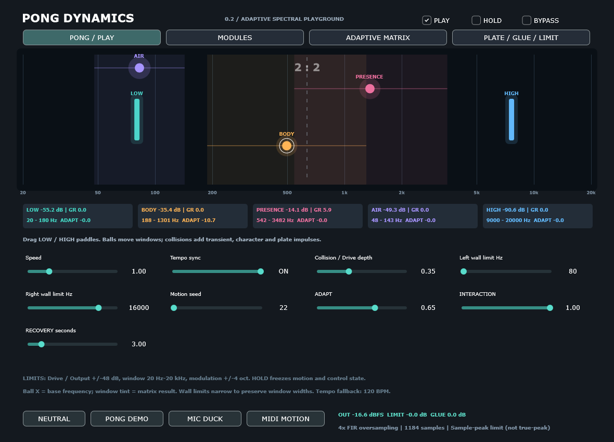
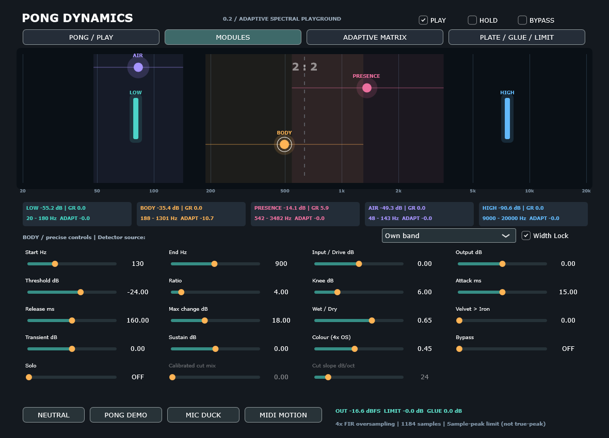
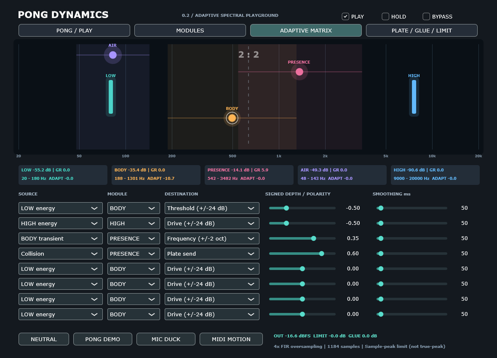
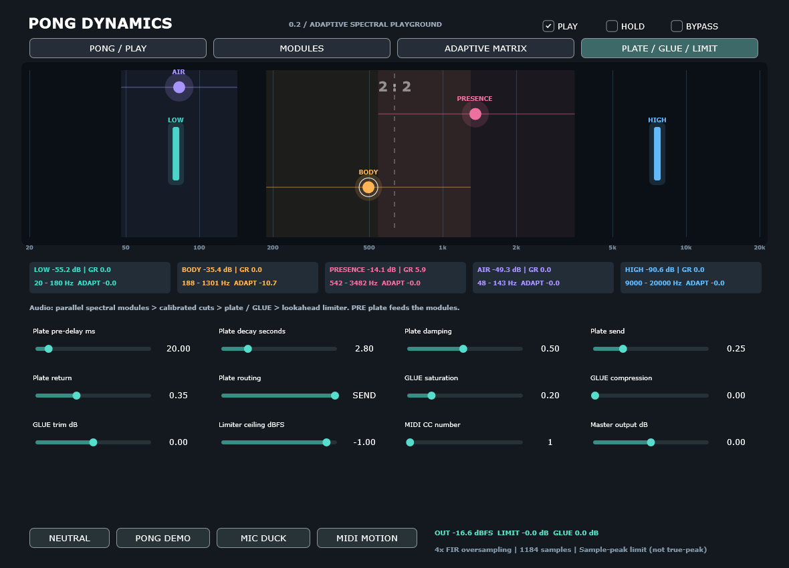

# PONG DYNAMICS

**An adaptive spectral playground by PADDO & SOUL22.**

PONG DYNAMICS is an experimental audio effect that turns spectral dynamics into a playable instrument. Five overlapping frequency modules combine compression, transient shaping and saturation; three moving Pong bodies animate the inner frequency windows, while collisions introduce bursts of character, transients and plate reverb.

**Version 0.2.0 · Windows x64 · VST3 & Standalone · C++20 · JUCE 8.0.12**



*Actual JUCE editor capture included with the original build; not a concept rendering.*

## What it does

- **Five spectral modules:** LOW, BODY, PRESENCE, AIR and HIGH, with overlapping frequency windows, module mix, solo and bypass.
- **Two original dynamics characters:** VELVET and IRON, continuously blended, with attack/release, knee, transient/sustain shaping and fixed 4× saturation oversampling.
- **Playable motion:** three frequency bodies, draggable boundary paddles, collisions, scores, tempo sync, repeatable seeds and HOLD. Motion advances with audio processing.
- **Eight modulation routes:** band energy, transients, sidechain, MIDI and collision sources control drive, threshold, frequency, character or plate send, with signed depth and smoothing.
- **Adaptive control:** sustained high levels or gain reduction can reduce drive and modulation; recovery is adjustable.
- **Finishing tools:** plate-style FDN reverb with PRE/POST/SEND routing, GLUE compression/saturation, independent 12/24/48/96 dB/oct cuts and a stereo-linked lookahead sample-peak limiter.
- **Host integration:** mono/stereo processing, external sidechain, MIDI note/velocity/gate/CC control, 165 host parameters and saved motion/control state.

These are original algorithms, not circuit-accurate recreations of vintage hardware. The routing matrix carries modulation, not freely patchable audio connections.

## Download

Download [the full Windows and source package](PONG-DYNAMICS-0.2.0-AGPLv3.zip), then extract it. It contains the VST3 bundle, standalone executable, all project sources, unpacked JUCE and documentation.

## Quick start — Windows / Ableton Live 11

1. Close your DAW.
2. Copy the **entire** `Windows/VST3/PONG DYNAMICS.vst3` bundle to `C:\Program Files\Common Files\VST3\`.
3. Enable the VST3 system folder in your DAW and rescan plugins.
4. Insert **PONG DYNAMICS** on an audio track and select **PONG DEMO** to explore motion, dynamics, the matrix and reverb together.

For standalone use, launch `Windows/Standalone/PONG DYNAMICS.exe` and select your audio device and buffer settings. The Microsoft Visual C++ 2015–2022 x64 runtime may be required. The supplied build does not request AVX/AVX2.

| Starting point | Purpose |
| --- | --- |
| NEUTRAL | Reset processing controls |
| PONG DEMO | Explore the combined creative effect |
| MIC DUCK | Use an externally routed microphone/sidechain detector |
| MIDI MOTION | Explore note, velocity and CC modulation |

External sidechain and MIDI routing depend on host support. The standalone app does not include an additional sidechain patchbay. MIDI controls the effect; this is not a synthesizer.

## Interface

| Page | Controls |
| --- | --- |
| PONG / PLAY | Motion, walls, tempo sync and adaptive behavior |
| MODULES | Frequency windows, dynamics, saturation and detector sources |
| ADAPTIVE MATRIX | Eight source → module → destination routes |
| PLATE / GLUE / LIMIT | Reverb routing, bus character and output limiting |

The Pong field remains visible on each page. Horizontal movement sets base frequency on a logarithmic scale; vertical movement offsets drive. The shaded windows show effective frequencies after modulation.

<details>
<summary>More screenshots</summary>







</details>

## Build from source

The repository includes the complete JUCE 8.0.12 sources in `JUCE-8.0.12-source.zip`. CMake automatically extracts them into the build directory when `vendor/JUCE` is absent; no submodule checkout or framework download is needed. The full download package also includes the original unpacked framework.

### Windows VST3 and Standalone

Requirements: CMake 3.22+, Visual Studio 2022 C++ Build Tools with Windows SDK, and a C++20 compiler.

```powershell
cmake -S . -B build -G "Visual Studio 17 2022" -A x64
cmake --build build --config Release --parallel 2
ctest --test-dir build -C Release --output-on-failure
```

Plugin outputs are under `build/PongDynamics_artefacts/Release/`.

### DSP-only tests

The standalone DSP tests do not require JUCE or an audio device.

```sh
cmake -S . -B build-tests -DPONG_PLUGIN=OFF -DCMAKE_BUILD_TYPE=Release
cmake --build build-tests --config Release --parallel 2
ctest --test-dir build-tests -C Release --output-on-failure
```

`pong_render` generates synthetic, RMS-matched listening examples in `Audio-v2/` beneath its working directory. The supplied examples are in `Audio/`. Native Linux/macOS plugin and standalone builds have not been verified.

## Validation and limitations

The publication review on **8 November 2026** verified all **3,139 original file checksums** and all project-local includes. Fresh GCC C++20 builds passed **26 DSP checks and 23 feature checks**, with zero failures. See [the review](docs/PUBLICATION-REVIEW.md) and its recorded outputs.

The original package also includes Windows build logs and a JUCE processor/editor harness. Those historical results are preserved separately; they are not a fresh Windows or Ableton certification.

- **Fixed latency: 1,184 samples** — approximately 24.67 ms at 48 kHz. Dry and bypass paths are compensated.
- **The output limiter remains active during global bypass.** Neutral reconstruction applies below its ceiling.
- **Sample-peak limiting, not true-peak limiting:** no intersample-peak guarantee.
- **Host testing:** a fresh Windows build, Ableton Live 11 integration, pluginval and real hardware latency tests remain outstanding.
- **Automation compatibility:** expanded ±48 dB ranges can change the meaning of normalized automation recorded with v0.1. Back up existing projects.
- **Saved state:** parameters and motion/control state are stored; audio buffers, reverb tails and held MIDI notes are not.
- **Performance:** oversampling and spectral processing cost CPU; offline benchmarks do not guarantee real-time performance on a particular computer.

## Project layout

| Path | Contents |
| --- | --- |
| `Source/` | DSP, motion/control engine, JUCE processor and editor |
| `Tests/` | DSP, feature, render and JUCE processor/editor tests |
| `JUCE-8.0.12-source.zip` | Complete bundled JUCE 8.0.12 source and third-party notices |
| `PONG-DYNAMICS-0.2.0-AGPLv3.zip` | Full package, including `Windows/` binaries and all sources |
| `Audio/` | Four synthetic comparison clips |
| `docs/` | Screenshots, architecture, manual and validation records |

## Documentation

- [Detailed user guide — Deutsch](docs/USER-GUIDE.de.md)
- [DSP architecture — Deutsch](docs/ARCHITECTURE.md)
- [Original validation scope — Deutsch](docs/VALIDATION.md)
- [Publication source review](docs/PUBLICATION-REVIEW.md)
- [Third-party licensing](THIRD_PARTY_NOTICES.md)

## License

PONG DYNAMICS is released under the **GNU Affero General Public License v3.0 (AGPL-3.0-only)**. See [LICENSE](LICENSE) for the full terms. You may use, study, modify and redistribute the project, including commercially, subject to those terms. The software is provided without warranty.

Bundled dependencies retain their own license terms. JUCE 8.0.12 is used under its AGPLv3 option; see [third-party notices](THIRD_PARTY_NOTICES.md) and [the framework license](JUCE-LICENSE.md).

## Credits

Concept and creative direction: **PADDO & SOUL22**. Developed with assistance from ChatGPT Work. Built with JUCE and the third-party components identified in the bundled notices.
